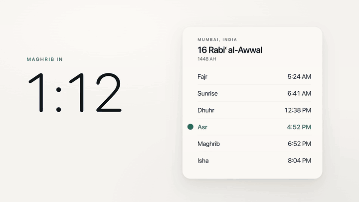
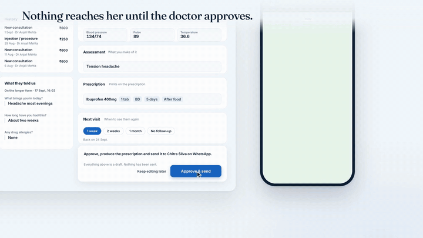
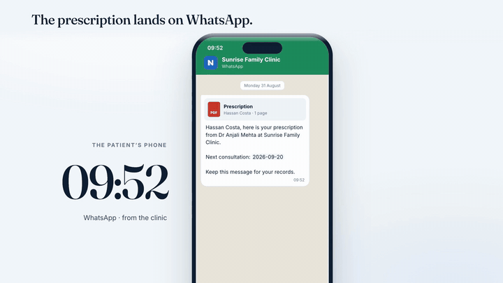

<div align="center">

# brag-motion

**You built it. Now brag — in 30 seconds, 45 seconds or a minute.**

Your coding agent reads the project you built, plans a launch film in the right tone, rebuilds your real UI, composes its own soundtrack, checks every claim on screen against your code, and hands you the video with a poster and share copy. Then you point at any frame to change it.

[](LICENSE)
[](https://agentskills.io)
[](#install)

```text
let's /brag --length 45
```

[Examples](#examples-30-s-45-s-1-minute) · [Install](#install) · [Prompts](PROMPTS.md) · [How it works](#how-it-works) · [Commands](#commands) · [Credits](CREDITS.md)

</div>

brag-motion joins two open-source projects and adds what was missing between them: **[/brag](https://github.com/latent-spaces/brag)** (the one-command launch-video workflow: inspect, tones, creative laws, never publish secrets) running on **[huashu-motion](https://github.com/alchaincyf/huashu-motion)** (the engine: HTML + GSAP films rendered frame by frame in your own Chrome, a composer that writes the score, and a studio where you click the frame to give notes). New here: **film lengths of 30 s / 45 s / 60 s**, an **honesty and privacy check** for everything on screen, one-command **delivery** with a baked-in poster, and a **setup** that works without Homebrew.

---

## Examples: 30 s, 45 s, 1 minute

All three were made with brag-motion, from the apps' own code and demo data. Full-quality MP4s with sound (16:9 and 9:16) are on the [release page](https://github.com/shaaz1000/brag-motion/releases/latest).

### 30 seconds — Noor, an iOS app for daily Muslim practice



`/brag --length 30 --tone polished` · 120 BPM, 15 bars. One green line — the app's own countdown bar — carries the whole film: it ticks down today's prayer times, races through six skies on the beat, curls into the dhikr ring (1 → 33), swings into the qibla needle (280°, computed for Mumbai, not copied from a mockup) and lands as the dot of نور. Percussion-only soundtrack, chosen for the audience.

### 45 seconds — Novic, clinic software



`/brag --length 45 --tone polished` · 112 BPM, 21 bars, two drops. The front desk, the doctor and the follow-up — without anyone retyping anything. Every name, number and message is the app's real demo data and template wording, checked with `om claims`.

### 1 minute — A day at Sunrise Family Clinic



`/brag --length 60` · 120 BPM, 30 bars. Morning dashboard → online booking → queue → consultation and Approve & send → WhatsApp → payment → follow-up → the evening's reports, with a montage burst through everything else the product does.

Also on the release page: seven 20-second **feature films** for Novic (patient history, dashboard, payments, follow-ups, templates, online booking, team roles) in 16:9 and 9:16, and Noor in three directions.

---

## Install

**Claude Code**

```text
/plugin marketplace add shaaz1000/brag-motion
/plugin install brag-motion@brag-motion
```

**Codex**

```bash
codex plugin marketplace add shaaz1000/brag-motion
codex plugin add brag-motion@brag-motion
```

**Any agent with skills** (Cursor, Codex, Copilot, Gemini CLI, opencode…)

```bash
npx skills add https://github.com/shaaz1000/brag-motion --skill brag
npx skills add https://github.com/shaaz1000/brag-motion --skill huashu-motion   # the engine /brag runs on
```

**Or clone it** — the skills call the CLI in the repo, so one checkout serves everything:

```bash
git clone https://github.com/shaaz1000/brag-motion.git
ln -s "$PWD/brag-motion/skills/brag" ~/.claude/skills/brag
ln -s "$PWD/brag-motion/skills/huashu-motion" ~/.claude/skills/huashu-motion   # Codex: ~/.codex/skills/
```

The repo also exposes both skills at `.claude/skills/`, `.agents/skills/` and `.opencode/skills/`, so an agent opened inside it finds them with no setup.

### What it needs

| | |
|---|---|
| **Node 22+** | The `om` launcher finds one from nvm, fnm or Volta by itself when your shell's `node` is older. |
| **Chrome** (or Chromium / Edge) | Already on most machines. Used to render, preview and grab stills; nothing is downloaded. |
| **FFmpeg + ffprobe** | `om setup` installs a local copy if you have none — no Homebrew, no admin rights. Or `brew install ffmpeg` / `apt install ffmpeg`. |
| Real instruments *(optional)* | `om samples build` once: a ~55 MB pack of CC0 / CC-BY piano, strings and drum kits. Without it the score plays on synthesised instruments. |

Check everything with `om doctor`. Tested on macOS.

---

## Use it

From any project, tell your agent:

```text
let's /brag
```

Or steer it — [PROMPTS.md](PROMPTS.md) has more, ready to paste:

```text
/brag --length 60 --tone cinematic
/brag --length 30 --format vertical
/brag https://your-site.com
/brag just the new search feature
/brag every feature — one 20-second film each, 16:9 and 9:16
/brag --tone "fake Series A launch from 2016"
```

| Option | Values | Default |
|---|---|---|
| `--length` | `30` · `45` · `60` (any 10–180 seconds) | 30 (feature films 20) |
| `--tone` | `default` · `polished` · `yc-parody` · `chaotic` · `deadpan` · `cinematic` · `app-store`, or your own words | inferred |
| `--format` | `landscape` · `vertical` · `square` · `both` | landscape |
| `--voice` | narration (system voice or your recording, word-synced, with subtitles) | off |
| `--no-music` · `--no-sfx` | | on |
| `--to <folder>` | collect every finished video in one place | — |

When it finishes you get `brag-output/` with the film, a poster, `share-copy.txt` and the plan — and the agent offers the studio:

```bash
om studio brag-output/composition
```

Press **C**, click anything in the frame, type what to change. The agent receives the time, the scene, the element and its source line, looks at that frame, changes only that, and the preview reloads where you were. Every version is kept.

---

## How it works

```
1 Inspect   read the code (or the live site): real UI, colours, fonts, logo, the product in use — never secrets
2 Plan      brag-plan.md: angle, hook, highlights, punchline, tone · om skeleton --length 45 → the bars
3 Build     one index.html (HTML + GSAP), the real UI rebuilt, a composed score on the same beat grid
4 Verify    om check · om still · om claims --source . · om render · om qa
5 Deliver   om deliver --to ~/Videos/launches → video + poster as frame 0 + share copy
```

### Lengths — `om skeleton`

A longer film is not a slower film. `om skeleton` picks the tempo whose whole bars land exactly on the length, so the score fits the picture without stretching, and lays out where everything goes:

```text
$ om skeleton --length 45
skeleton 45.00 s (asked 45 s) · 112 BPM · 21 bars of 2.14 s — launch film: a small drop at a third, a burst, the big drop, proof, the mark

scene         bars     time            energy  events/bar  what
hook          1–1      0.0–2.1 s       7       3–4         frame 1 already moves; the one image or line that makes a stranger stay
highlight-1   2–4      2.1–8.6 s       5       2–4         entry: the product in use, its real UI
highlight-2   5–6      8.6–12.9 s      6       2–4         the next capability, carried from the last by one shared object
highlight-3   7–10     12.9–21.4 s     6       3–4         small drop: a lift a third in — new texture, the camera starts travelling
burst         11–13    21.4–27.9 s     9       4–8         montage: cuts on every beat, then half-beats
build         14–15    27.9–32.1 s     7       2–3         build to the drop … last half-beat silent (the stop)
drop          16–18    32.1–38.6 s     10      2–3         the hero moment on the strongest beat (impact + subdrop)
proof         19–19    38.6–40.7 s     7       2           payoff: the result, a number with a source, the claim
mark          20–21    40.7–45.0 s     3       1           the logo and one line, held

marks    small drop 12.857 s (29%) · stop 31.875 s · drop 32.143 s (71%)
```

| Length | Tempo | Shape |
|---|---|---|
| **30 s** | 120 BPM · 15 bars | hook → 2 highlights → burst into the drop at ~53 % → proof → mark |
| **45 s** | 112 BPM · 21 bars | hook → 3 highlights with a small drop at ~29 % → burst → build → big drop at ~71 % → proof → mark |
| **60 s** | 120 BPM · 30 bars | hook → 4 highlights with a small drop at 30 % → burst → build → big drop at 73 % → proof → mark |

### Honesty and privacy — `om claims`

The worst bug a launch film can have is a true-looking claim that isn't true. `om claims` lists every string and number the film puts on screen and looks each one up in your product's source (skipping dependencies, build output and secret files). It also flags emails, phone numbers, API keys and internal addresses — nothing private goes into a public video.

```text
$ om claims brag-output/composition --source .
claims   77 on-screen strings · 40 found in ~/novic (391 files) · 37 not found · 0 numbers not found

Not found in the product — real copy reworded, a caption, or an invention? Keep captions; check the rest:
  ✗ Your consultation at Sunrise Family Clinic is confirmed for 18 September at 10:00 …   (text)
  …
Personal data or secrets on screen — a public film must not carry them (use fictional stand-ins):
  ! phone number: +91 22 2600 1234   in "Ring +91 22 2600 1234 if anything changes."
```

That first line is real: while the Novic films were being made, this kind of check caught a WhatsApp confirmation the app has a template for but never sends. The film was changed — and the product got a bug report.

### Delivery — `om deliver`

Picks the strongest *settled* frame as the poster (not mid-transition, not blank), bakes it in as frame 0 so every platform's thumbnail shows it — replacing the frame, so length and audio sync stay exact — puts the share copy beside it, and with `--to` collects everything in one folder.

---

## Commands

The skills drive all of these; you can run them yourself too. `om` is `skills/huashu-motion/bin/om` (or `npx github:shaaz1000/brag-motion`).

| Command | What it does |
|---|---|
| `om skeleton --length 30\|45\|60` | the film's shape before building: tempo, bars, scenes, drops |
| `om new <dir> [--template t]` · `om templates` | start a film project |
| `om studio [dir]` | live preview, direct edits, click-the-frame comments |
| `om inbox [dir] --wait` · `om look <id>` · `om done <id> --note …` | the agent's comment loop |
| `om check [dir]` · `om still <dir> --at 1,2.5` | structure and sampled-frame checks; PNG stills |
| `om sound [dir]` · `om samples build` | the composed score and effects; real instruments |
| `om voice <dir> --text … \| --audio …` | narration with word cues and subtitles |
| `om render [dir] [--blur] [--format mp4\|mov\|webm\|gif]` | export to `<dir>/out/` |
| `om qa [dir]` | pops, dead time, cuts, motion curve |
| `om claims [dir] --source <product>` | on-screen claims vs. the source; privacy |
| `om deliver [dir] [--at s] [--to folder]` | poster as frame 0, share copy, collection folder |
| `om fork <dir> <newdir> --size 1080x1920` | another format, re-laid out (not cropped) |
| `om export html [dir]` | a static share page with player and source |
| `om setup` · `om doctor` | local FFmpeg; environment check |

Engine details — the composition contract, director, colour, rhythm and sound references — are in [`skills/huashu-motion/`](skills/huashu-motion/SKILL.md).

## Development

```bash
npm test     # the engine's suite plus claims, deliver, skeleton and tools
```

The render tests drive a real Chrome and take a few minutes; the new commands' tests take seconds:
`node --test test/claims.test.js test/deliver.test.js test/skeleton.test.js test/tools.test.js`.

## Credits & license

MIT. brag-motion is built on [huashu-motion](https://github.com/alchaincyf/huashu-motion) by 花叔 Huashu and [/brag](https://github.com/latent-spaces/brag) by Shunit Haviv Hakimi (latent-spaces), both MIT — see [CREDITS.md](CREDITS.md). Bundled fonts, GSAP and the instrument pack keep their own licenses — see [THIRD_PARTY.md](THIRD_PARTY.md).
